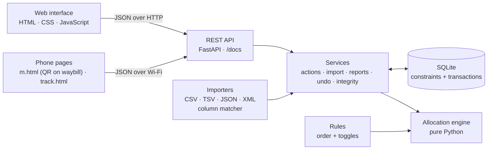
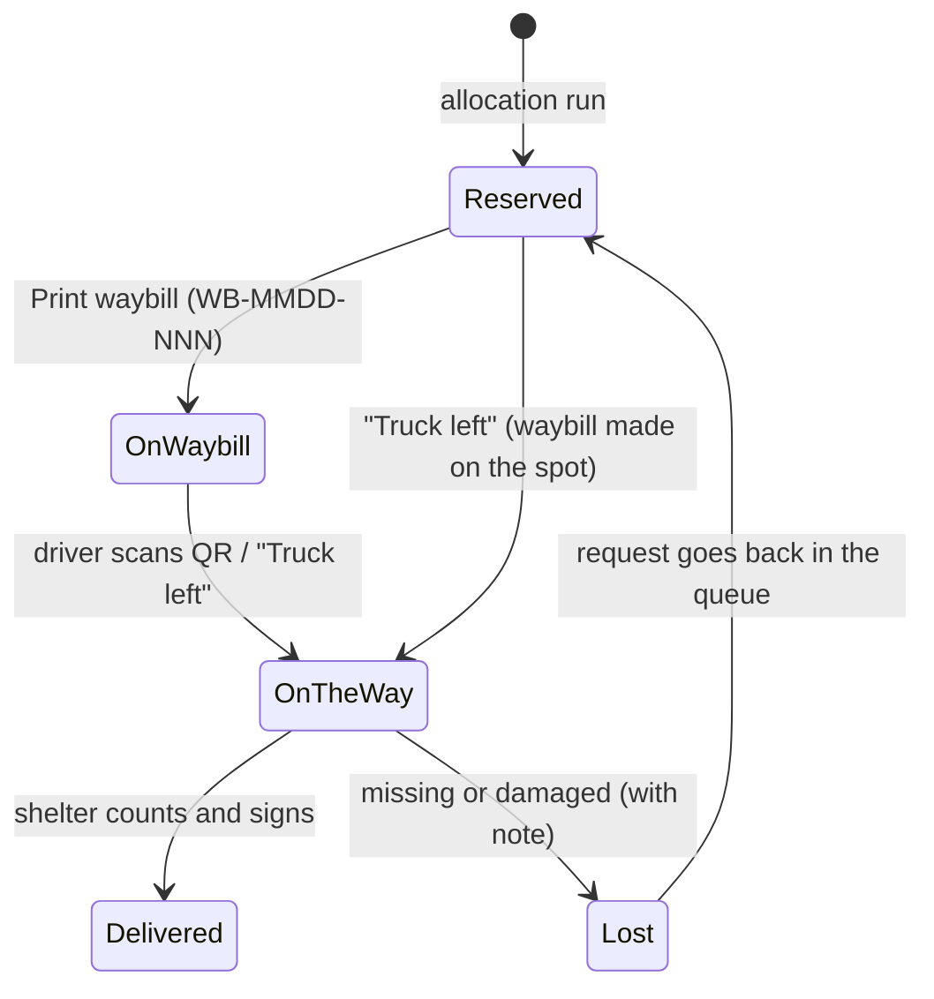
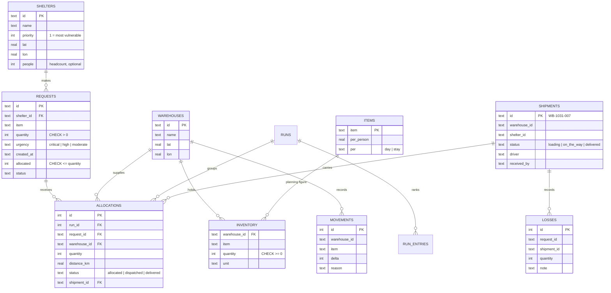

# Architecture

Requests flow one way: interface → REST API → services → engine and database. The engine never touches the
database or the web, so it can be tested on its own and a rule change never breaks the screens.

## Waybills and proof of delivery

Only rows on the waybill leave with the truck (and with `upto_id`, only what the driver was shown), so stock
reserved after printing waits for the next truck. Phone links carry an HMAC code tied to the waybill number:
anyone can track, only the holder of the slip can confirm. Waybill numbers come from a counter outside Undo, so a
number is never handed out twice.

## One change, step by step

Every change (new request, restock, import, cancel, rule change) runs inside **one database transaction**:

1. Save an undo snapshot.
2. Make the change (and record every stock change in `movements`).
3. Run the engine on all waiting requests.
4. Write allocations, deduct stock, store each request's explanation, log events.
5. Commit. If anything fails, everything rolls back: stock is never deducted without its allocation being recorded.

## Data model

`movements` is a ledger of every stock change ever made. The "Stock adds up" integrity check confirms that current
stock equals the sum of the ledger for every item in every warehouse.

## The engine

`allocate(requests, stock, warehouses, rules) -> (decisions, stock_after)`

- Sorts waiting requests by `(urgency, shelter priority, time submitted, request ID)`.
- For each: works out what it still needs (after any per-shelter cap, in units or in days of need for the
  shelter's headcount) and what it may use (after any Critical reserve), then takes from warehouses nearest first.
- Returns one `Decision` per request with everything needed to explain it: its rank, the stock at its turn, what
  the requests ahead of it took, and where its units came from.
- Never modifies its inputs. Sorting is O(n log n); each request scans the warehouses for its item.
  10,000 requests take about 0.1 s.

## Integrity checks

| Check | How |
| --- | --- |
| Nothing below zero | No inventory row is negative (also enforced by a CHECK constraint) |
| Stock adds up | Inventory equals the sum of all movements, per item per warehouse |
| No request over-filled | allocated ≤ quantity, and allocated equals the sum of its allocation rows |
| Whole units only | Every quantity is stored as an integer |
| Priority order kept | In every run, nobody lower down got stock while someone above went short; and a dry run finds no idle stock that a waiting request could use |
| Same result on re-run | The engine run twice, once on shuffled input, gives identical results |
| Every load on a waybill | Every unit that left a warehouse is on a waybill whose stage matches; every waybill that left has a driver, every delivered one a signature |
